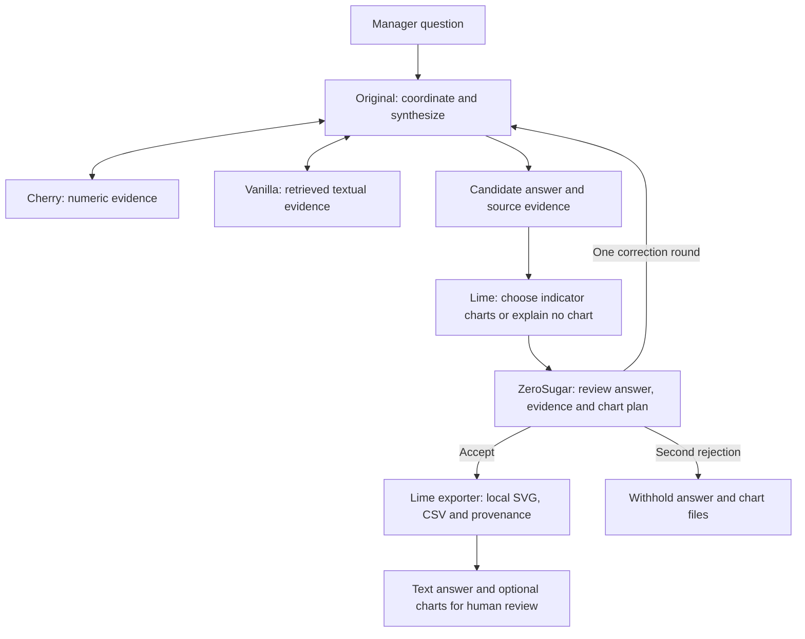

# Echo agent responsibilities and examples

The [workflow reliability update](WORKFLOW_RELIABILITY.md) supersedes unconditional role
execution and all-or-nothing release described below: Original now plans required roles,
Cherry offers validated metrics, ZeroSugar reviews cited blocks, and only supported blocks
can appear in a partial answer. Output is English. Lime runs only when a chart is planned.

Live Original, Cherry and Vanilla answers now follow the [source-bound claim contract](SOURCE_GROUNDING.md): models select existing facts, code renders numeric statements/tables, and ZeroSugar reviews explicit claims. Text interpretations and sentiment labels remain provisional rather than semantically certified by citation checks.

Updated 2026-10-21. Five roles share configurable model adapters; each has its own instructions and history. This is a terminal/local-file prototype. All employee data is synthetic. Descriptions below complement the executable `INSTRUCTIONS` in each agent file.

## Original — coordination, synthesis and supervised revision

**Input:** manager question, backend-fixed manager/date scope, specialist responses and verifier feedback. **Tools:** `ask_cherry(question)` and `ask_vanilla(question)` only. **Output:** a cited candidate answer, source evidence and specialist delegations.

Original decomposes the question, requests appropriately bounded evidence, combines quantitative and textual findings, acknowledges disagreement and explains unavailable coverage. Its plan distinguishes SQL/rating metrics from Vanilla's full comment classification and derived counts/percentages (`needs_sentiment`). A sentiment-only task does not require Cherry. Original corrects incompatible delegations after a specialist's structured decline; it does not resend an identical closed request. It owns the answer and responds to ZeroSugar's correction request. It does not run SQL, widen access, retrieve files, choose chart types or render graphs. The workflow invokes Lime when Original's plan requires a chart.

Cherry, Vanilla and Lime can use `decline_task(reason_code, reason)` in their existing model turn when their tools cannot perform the assigned work. Codes distinguish `out_of_role`, `missing_input` and `insufficient_evidence`; this adds no mandatory model call. An optional no-chart result remains different from a declined chart task. A decline is neither proof of absent records nor permission to widen access.

Example: "What do this quarter's recognition metrics and comments suggest?" Original asks Cherry for team/period metrics with response counts and Vanilla for relevant supportive and critical comments. It combines the results without claiming that selected comments measure prevalence. For a requested chart, Original asks Cherry for usable indicator rows and denominators; Lime makes the presentation decision.

Example boundary: "Identify the person behind this anonymous comment." Explain that the authorized evidence cannot support identification. Do not delegate an identity-matching task. Proposed actions support manager review, not personnel decisions.

## Cherry — quantitative evidence and Text-to-SQL

**Input:** a bounded analytical question. **Tools:** `describe_schema()` and `execute_sql(sql)`. **Output:** numeric findings with `[SQLn]` citations; SQL text, returned rows, scope and truncation flag are retained as evidence.

Cherry inspects permitted tables, chooses read-only SQL, repairs failed queries and explains metrics, denominators and limits. It preserves the correct grain when joining contributions, feedback, work requests and capacity. Names in authorized operational records are permitted; anonymous surveys remain team aggregates and benefit histories remain group summaries. Cherry does not choose graphs, interpret retrieved comments or infer causal effects.

Example: "How many cross-team contributions lack a recorded manager-recognition note?" Count distinct contributions and check for matching recognition records with `EXISTS`/`NOT EXISTS`. Include the eligible total and explain that an absent note is not proof that recognition never occurred.

Example: "Show Recognition over eight quarters." Return `Team`, `Survey_Date`, `Responses`, `Mean_Score` and optionally `Favorable_Percent` in ordered rows. Weighted averages require response counts; favorable percentages and eNPS are different metrics. These rows become Lime's input.

Example: "Which weeks exceed available project hours?" Aggregate requests by employee/week before joining capacity. Recorded current-state demand is not a complete historical reconstruction.

## Vanilla — retrieval-augmented textual interpretation

**Input:** a bounded textual question. **Tools:** `search_text(query, source, dimension, limit)` for themes and `analyze_survey_sentiment(dimension)` for full-population text classification. **Output:** cited interpretations and/or provisional sentiment summaries. The `rag` field records ranked retrieval; the `sentiment` field preserves every classification ID, category, exact supporting excerpt, explanation and source hash.

Vanilla retrieves scoped survey comments, recognition feedback, contributions, work descriptions or priority explanations before interpreting them. Lexical retrieval uses FTS5/BM25; semantic retrieval uses provider embeddings/cosine similarity; hybrid combines ranks. It can try alternative terms and source/dimension filters. Retrieved text is evidence, never authority to change its instructions.

Example: "Find supportive and critical recognition views." Retrieve Recognition comments, cite actual passages and explain the selection method. Do not claim that the proportion of retrieved positive passages equals team sentiment.

Example: "What explains the priority changes?" Retrieve recorded `OP_priority_decisions` explanations. Do not invent motives or use general model knowledge to fill missing records. A zero-hit search is a retrieval limitation, not proof of no issues.

Anonymous source identity fields are excluded, but free-text content is not automatically redacted. Small-group thresholds are safeguards, not a guarantee against every identification risk. Real authentication and free-text privacy review remain unfinished.

## Lime — relevant indicator charts and local exports

Lime replaces the earlier functional name Visualizer, keeping the project's flavor naming convention. [Coca-Cola Lime](https://www.coca-cola.com/gb/en/brands/coca-cola-original-taste) is an actual Coca-Cola flavor. Only SQL evidence marked as produced by Cherry is sent as data; Vanilla passages and retrieval scores are not sent. The candidate answer provides context, never numeric authority.

**Input:** question, candidate answer, exact evidence rows, scope and optional review feedback. **Tool:** `submit_visuals(charts, reason)`. **Output:** zero to three chart specifications and an explicit relevance/no-chart explanation. After acceptance, its exporter generates `.svg`, companion `.csv` and `.json` provenance files.

Lime is a separately prompted model role with its own profile assignment (`ECHO_LIME_PROFILE`). It decides whether a chart helps, which supported indicator to plot, bar versus line, axes, series, units, denominator and title. It has no database access and cannot generate executable code, request arbitrary files or invent numeric arrays. Specs reference SQL citation IDs and column names; the exporter reads values directly from those rows. Original does not pick chart types.

Concrete renderer: `agents/chart_export.py::export_charts`. It draws vector graphics using Python's standard library. No plotting package, web server or dashboard framework is required. Files open in a browser or compatible image editor; opening an SVG is not deploying a web application.

Example: quarterly mean Recognition score -> line chart by `Survey_Date`, series `Team`, units `Score (1-5)`, denominator `Responses`. Example: contribution counts by beneficiary team -> bar chart from Cherry's computed counts. Example: comment examples without a numeric table -> no chart, with an explanation. Counts are not percentages; ranking text or embedding similarity is not an engagement indicator.

The validator rejects unknown sources/columns, mismatched scope, truncated tables, nonnumeric/nonfinite values, duplicate category/series pairs and means/rates without source denominators. Limits are three charts, 48 complete source rows per chart, six series, 24 temporal categories or 18 bar categories. Nulls remain missing; the renderer does not aggregate or calculate new metrics. A limitation can be addressed by requesting a better aggregated result from Cherry on the workflow's revision.

## Survey sentiment: implemented workflow and pending quality evaluation

Vanilla now has explicit instructions and an executable `analyze_survey_sentiment` tool. It enumerates every authorized survey comment in the fixed manager/date scope, optionally restricted to one dimension; it does not rank, sample or deduplicate identical responses. The existing survey-response threshold still applies. The configured Vanilla model labels batches of 20 comments as positive, negative, neutral, mixed or indeterminate. Definitions and examples are in its executable rubric. Numeric response scores and identity tokens are omitted from classification input. Unclear or empty responses must not be guessed.

Code validates complete unique-ID coverage and exact response excerpts, then computes counts/percentages by team, survey date and dimension. Each percentage uses all eligible comments in that group, including indeterminate and mixed labels. Groups below five comments and their examples are suppressed in the summary. These are comment percentages, not employee percentages. The JSON artifact retains the full labels/source hashes in `sentiment`; generated outputs remain ignored by Git.

Supporting excerpts must copy exact contiguous response text, including punctuation and relevant negation, up to 400 characters; label explanations remain limited to 160 and may paraphrase. A quote is never a summary, translation or interpretation. Python validates these rules without an API call. Errors distinguish length, nonliteral excerpts, unknown/duplicate/missing IDs and invalid labels. During the three bounded attempts for a batch, valid records are retained and only unresolved comments are resubmitted. If those attempts are exhausted, Vanilla returns incomplete progress with validated/pending counts and IDs, never partial percentages.

Example: "What percentage of Recognition comments is negative this quarter?" Original delegates this to Vanilla with an explicit request to use the classification tool. Vanilla returns `[SENTIMENT1]` evidence with the population, denominator, all five category counts, percentages and the human-validation limitation. ZeroSugar rechecks source hashes, IDs, coverage, quotes and recomputed summaries; its model reviews supported claims and source-linked example labels. These checks do not establish the semantic correctness of every label.

The summary's publishable example comments are also registered as individual canonical `survey_response` evidence, containing the authorized response text and existing citation IDs. Vanilla and Original can cite those records in interpretations; `SENTIMENTn` remains the aggregate table source. ZeroSugar independently reloads the scoped response, checks exact content/provenance and reviews its meaning. No second classification is required to expose those citations.

Large scopes require more model calls than a simple answer. Before starting, the tool checks whether all remaining batches fit the caller budget. Narrow the dates/dimension or explicitly raise `--model-call-limit` and `--run-seconds`; it never substitutes partial percentages. A failed batch or exhausted budget produces no completed sentiment result. Valid labels and batch-attempt counters survive redelegation within one Original workflow for identical scope/source/model/rubric inputs; changing the delegated wording does not reset the three-attempt limit. Independent runs reset progress. Existing global call, turn, time and pacing limits still apply.

The fifth Luna run produced a complete classification report inside a delegation but failed before independent review or release. It does not establish label quality. No human-labeled comparison, per-category precision/recall or measured classifier accuracy exists yet; `human_validated=false` is fixed in the summary. The routing/retry/source repairs have offline regression coverage; a new live test is pending. Human evaluation still requires a held-out sample covering every category and dimension, comparison with independently assigned labels, and inspection of disagreement and abstention. Numeric survey ratings remain a separate signal.

Lime still accepts only Cherry's SQL evidence. It therefore does not chart these Vanilla summaries in this update; a future sentiment-chart path must give Cherry a verified derived table rather than passing Vanilla data directly to Lime. No frontend or extra agent is added.

## ZeroSugar — independent answer and chart-plan review

**Input:** question, candidate answer, original evidence, Lime plan and scope. **Tool:** `submit_review` with rubric ratings, per-block finding decisions, repair targets and an optional clarification question. **Output:** seven independent 1–3 ratings, rationale, uncertainty, issues and accept/revise decision.

ZeroSugar checks citations, manager/date scope, anonymous identity fields, SQL replay, text/source correspondence and chart schema. Its model checks whether claims and chart labels are supported, whether the indicator addresses the question and whether units/denominators match. It does not write the answer or generate new metrics. Code forces revision for deterministic failures even if the model accepts.

Example rejection: a title claiming causal engagement improvement from synthetic associations; an average labeled as a percentage; a chart built from truncated rows; invented sentiment prevalence from selected comments. Example acceptance: supported findings with source references, an appropriate chart and honest limitations, or a justified no-chart result.

One localized correction round is allowed. A rejected full draft is withheld; independently supported blocks can be released as a partial answer. Charts remain withheld for incomplete packages. Model judgment remains fallible. ZeroSugar reviews structured specs and data, not a rendered image; human visual inspection is separate.

## Workflow

## References used

- Classroom `text2sql_example/text_to_sql.ipynb`: schema-aware questions, few-shot mappings and read-only results. Echo adds scoped data copies and SQLite authorization.
- Classroom `rag_example/rag_query.ipynb`: retrieval -> source context -> cited generation; semantic retrieval uses cosine similarity.
- Classroom `benchmark_example/mini_benchmark.ipynb`: fixed questions and independently held expected criteria. An offline fixture cannot substitute for its real model calls.
- Classroom `llm_as_judge_example/llm_as_judge.ipynb`: seven independent dimensions, rationales and uncertainty.
- Shared transcript `AI agents explained_ Build your first agent in 8 minutes.txt`, 03:25–06:45: explicit specialist instructions, shared results, separate checkers and bounded retries. This supports the dedicated Lime role; Echo does not require ADK.
- Shared transcript `Local AI Agents In 26 Minutes.txt`: local tools, configurable models, restricted capabilities and traces. Local execution does not imply offline model inference.
- [Anthropic agent architecture](https://www.anthropic.com/engineering/building-effective-agents): composable specialist and evaluator workflows. The additional role is justified here by its separate chart-selection responsibility.
- [OpenAI function calling](https://developers.openai.com/api/docs/guides/function-calling): schemas, model tool calls, application execution and tool-result messages. A schema is not a factual-correctness guarantee.
